# APEX: descarga, instalación y tutorial

APEX graba la telemetría de tus juegos de carreras y te dice qué mejorar. Incluye un análisis por vuelta con mapa, un ingeniero que te habla por voz, un overlay de pedales sobre el juego y un entrenador de pedales que funciona sin juego.

> Las capturas de esta guía usan una sesión simulada, no datos reales.

---

## 1. Descarga

1. Abre **[la última versión](https://github.com/JuanMaestro201101/simtel/releases/latest)**.
2. En *Assets*, descarga **`APEX-1.1-windows.zip`** (unos 70 MB).

**Requisitos:** Windows 10 u 11 de 64 bits. No hace falta instalar .NET ni nada más: el zip lo trae todo.

## 2. Instalación

APEX no tiene instalador. Basta con descomprimir el zip:

1. Haz clic derecho en el zip, elige **Extraer todo…** y descomprímelo en una carpeta tuya, por ejemplo `Documentos\APEX`.
   No abras la app desde dentro del zip: no guardaría bien sus archivos.
2. Abre **`APEX.exe`**.
3. Windows puede mostrar **«Windows protegió su PC»**, porque la app no está firmada. Pulsa **Más información** y luego **Ejecutar de todas formas**. Solo lo pide la primera vez.
4. Si quieres un acceso directo: clic derecho en `APEX.exe` → **Enviar a → Escritorio**.

**Actualizar:** descarga el zip nuevo y reemplaza `APEX.exe`. Tus vueltas y ajustes no se pierden, porque se guardan aparte, en `Documentos\SimTelemetry` y `%APPDATA%\SimTelemetry`.

**Desinstalar:** borra la carpeta de la app. Si además quieres borrar tus datos, borra esas dos carpetas.

## 3. Configura tu juego (una sola vez)

| Juego | Qué hacer |
|---|---|
| **Assetto Corsa Competizione, Assetto Corsa, iRacing** | Nada. Sal a pista y la app conecta sola. |
| **DiRT Rally 2.0, EA SPORTS WRC** | Pestaña **JUEGOS** → botón del juego, **con el juego cerrado**. Después abre el juego. |
| **Forza Motorsport / Horizon** | En el juego: *Ajustes → Interfaz y juego → Salida de datos*: **Activada**, IP `127.0.0.1`, puerto `5300`, formato **«Aceleración de auto»**. Cierra y vuelve a abrir Forza. En la versión de Game Pass / Microsoft Store pulsa también **«Dar permiso de red a Forza»** en **JUEGOS**. |
| **BeamNG.drive** | *Opciones → Otros → Protocolos*: activa **OutGauge** y **MotionSim**, los dos con IP `127.0.0.1` y puerto `4444`. Las vueltas se separan solas cada vez que pasas por donde empezaste. |
| **Live for Speed** | En `cfg.txt`: `OutGauge Mode 1`, `OutGauge IP 127.0.0.1`, `OutGauge Port 4444`. |

El **overlay** (los pedales sobre el juego) solo se ve con el juego en **ventana sin bordes**, no en pantalla completa exclusiva.

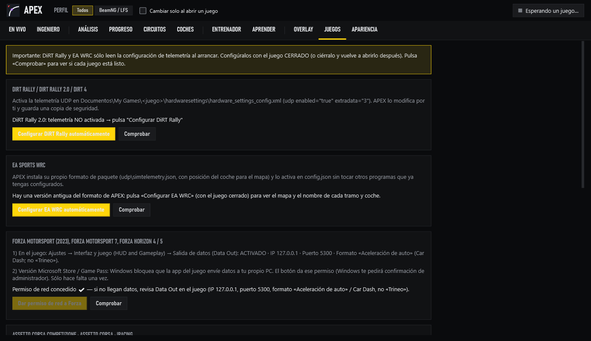

## 4. Volante o mando

- **En pista da igual con qué juegues:** el acelerador, el freno y el volante los envía el juego.
- **Volante o pedales USB:** pestaña **ENTRENADOR** → **Detectar pedales** y pisa cada pedal cuando te lo pida, sin tocar el ratón. Si un pedal va al revés, el Entrenador tiene botones para invertirlo.
  - Si tu volante (PXN y otros) tiene varios modos, ponlo en **modo PC / D-input**.
- **Mando (Xbox, 8BitDo…):** ponlo en **modo X-input** (el modo Xbox) y pulsa **Detectar pedales**. El gatillo **LT** es el freno y el **RT** el acelerador. Del embrague no hace falta nada: la detección termina sola.

## 5. Recorrido por la app

Arriba están el logo, el **perfil** del juego y el estado de la conexión. El perfil filtra lo que ves por juego; si marcas «Cambiar solo al abrir un juego», cambia solo. Debajo están las pestañas.

### EN VIVO
La primera vez verás **Primeros pasos**, con lo que te falta y un botón para cada cosa. Luego, mientras conduces: velocidad, marcha, RPM, tiempo de vuelta y una vista previa del overlay. A la derecha está la lista de juegos: el que está enviando datos se marca en verde.

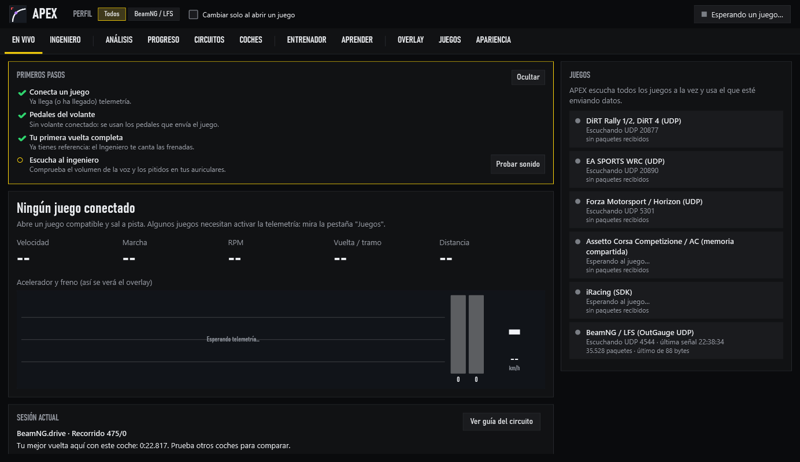

### INGENIERO
Te habla por los auriculares mientras conduces:
- **Avisos de frenada:** unos pitidos y, si quieres, voz («Fuerte, 90, segunda») antes de cada frenada, sacados de tu mejor vuelta.
- **Al cruzar la meta:** el tiempo de la vuelta, la diferencia con tu mejor vuelta y en qué curva pierdes más.
- **En ACC**, además: presiones de neumáticos y combustible.

Pulsa **Probar sonido**, elige la voz y el volumen y, si usas auriculares Bluetooth, pulsa **Auriculares Bluetooth** para adelantar los avisos.

En rally, por defecto solo suenan los pitidos, para no pisar la voz del copiloto.

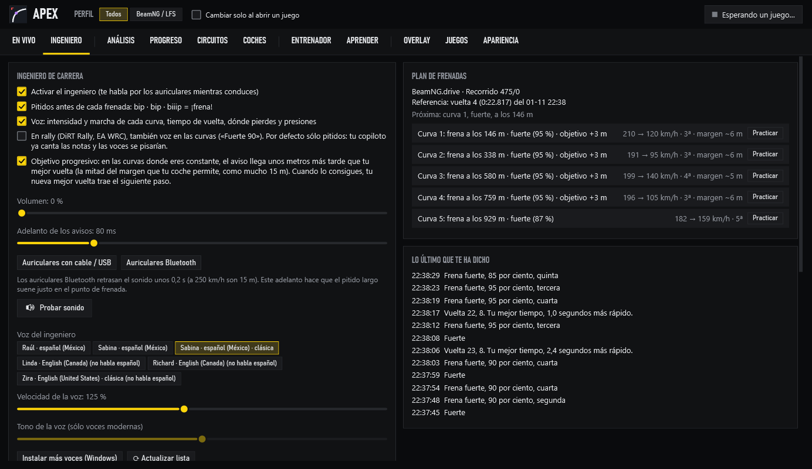

### ANÁLISIS
El corazón de la app. Cada vuelta se graba sola.

- **Izquierda:** las sesiones y la **torre de vueltas**. Tu mejor vuelta sale en **morado**; las demás, con su diferencia en **amarillo**; las inválidas, tachadas.
- **Centro:** el tiempo de la vuelta elegida, la diferencia con tu mejor vuelta, los **tres sectores** (verde = ganas, amarillo = pierdes) y las gráficas: velocidad, diferencia acumulada, pedales, volante, marcha y RPM.
- **Derecha:** el **mapa de la trazada**. Rojo es donde pierdes y verde donde ganas; la línea morada es tu mejor vuelta.
  - **Rueda del ratón:** zoom. Con zoom, la pista se dibuja a su anchura real.
  - **Arrastrar:** mover el mapa.
  - **Doble clic:** ver todo el circuito.
- **Abajo a la derecha:**
  - **Qué mejorar:** cada consejo te dice qué pasa, por qué y qué hacer, con un botón para practicarlo.
  - **Frenadas:** la nota de cada frenada.
  - **Métricas:** las cifras de la vuelta.

Al tocar un consejo o una frenada, las gráficas y el mapa saltan a esa curva.

La **referencia** es siempre tu vuelta más rápida y se actualiza sola cuando la mejoras. Si quieres comparar con otra, elígela y pulsa **Usar como referencia**.

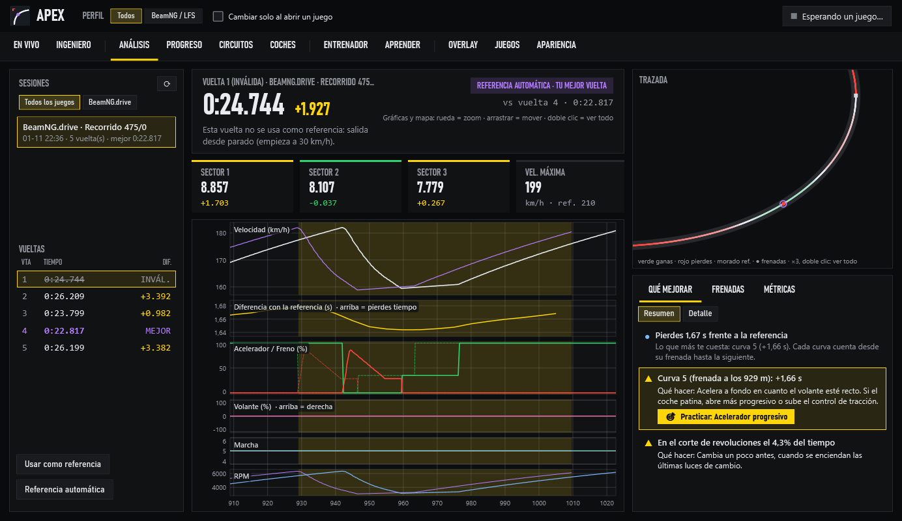

### PROGRESO
Cómo evolucionas sesión a sesión en cada circuito: mejor tiempo, constancia y técnica.

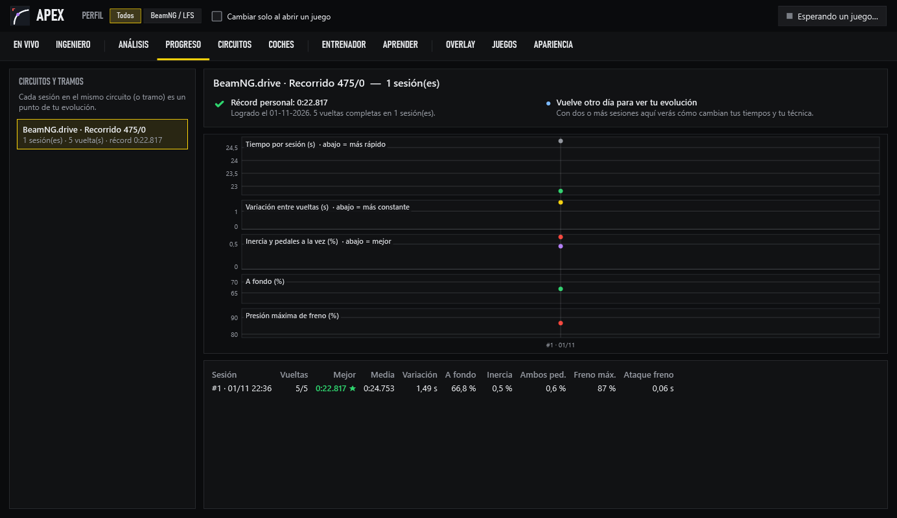

### CIRCUITOS
Primero los circuitos en los que ya corriste y después la biblioteca. En los tuyos ves:
- tu mejor vuelta y la **vuelta ideal** (juntando tus mejores tramos);
- tus puntos de frenada numerados en el mapa;
- el **coche recomendado** para ese circuito, cuando hay una fuente fiable.

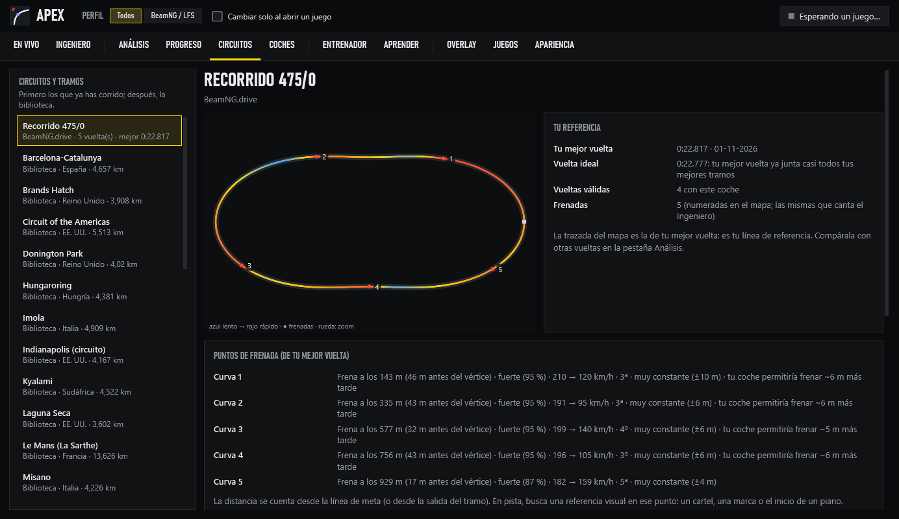

### COCHES
- **Tu estilo de manejo:** un gráfico de radar con 8 atributos de 0 a 100 (ataque al freno, presión, trail braking, fluidez, precisión, suavidad, control y constancia) y una nota global. Debajo, qué significa cada uno y cómo mejorarlo.
- **Con qué coches rindes mejor:** solo compara coches de la misma categoría en el mismo circuito, porque un GT4 siempre será más lento que un GT3.
- **Qué dicen las fuentes:** el mejor coche según fuentes externas, siempre con enlace y fecha. Si es solo opinión de jugadores, lo dice.

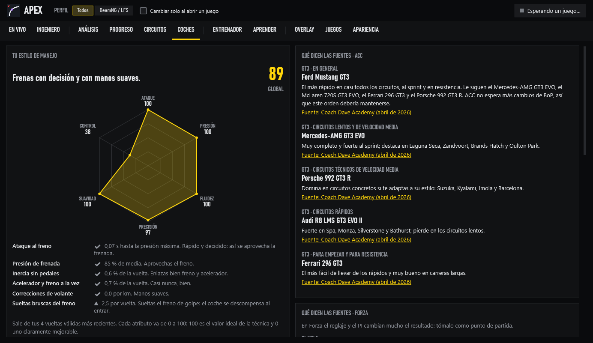

### ENTRENADOR
Ejercicios de pedales que funcionan **sin ningún juego**. Tu pedal es la línea de color y el objetivo es la banda amarilla; al terminar te da una nota. Practica presiones exactas de freno, soltar el freno poco a poco (trail braking) o acelerar de forma progresiva. También puedes simular cómo traduce tu pedal cada juego.

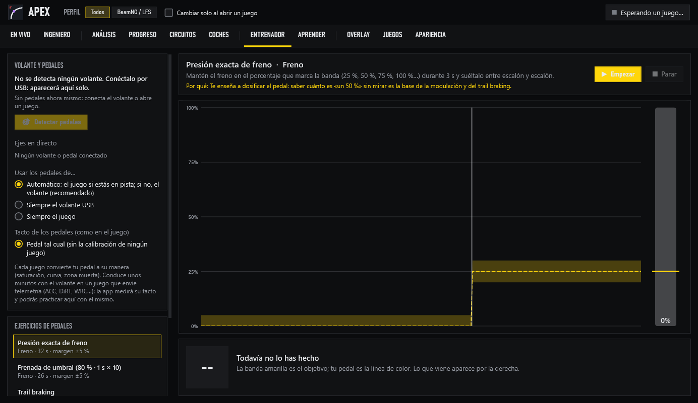

### APRENDER
Una guía de técnica: frenada, trail braking y salida de curva, con los valores con los que la app puntúa cada frenada.

### OVERLAY
Los pedales encima del juego:
- **Ver:** el overlay no recibe clics ni le roba el foco al juego.
- **Moverlo o cambiar su tamaño:** pulsa **Desbloquear**, arrástralo y vuelve a bloquearlo.
- **Elegir qué muestra:** la traza, las barras, la diferencia en directo y la curva en la que ganas o pierdes.

Aquí se activa también el **panel en el teléfono**: un código QR para ver la diferencia y la próxima frenada en el móvil, con la misma Wi-Fi.

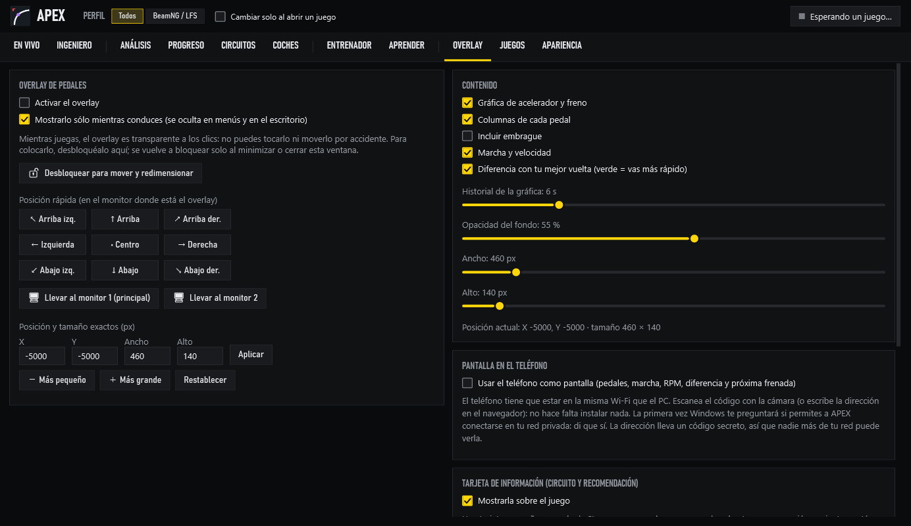

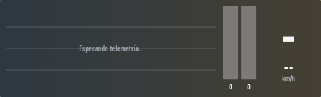

### JUEGOS
El estado de cada juego, los botones para configurarlos, los puertos y **Abrir registro de diagnóstico**.

### APARIENCIA
Tema oscuro o claro y el color de acento.

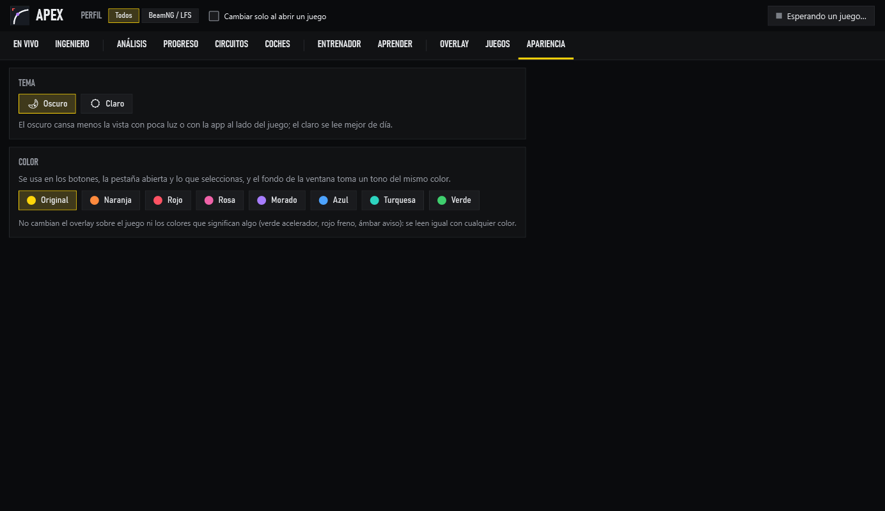

## 6. Problemas frecuentes

| Problema | Solución |
|---|---|
| «Esperando un juego…» con el juego abierto | Revisa el paso 3 para tu juego. En **JUEGOS → Comprobar** verás la causa. |
| Forza no envía datos | Formato «Aceleración de auto» (no «Trineo»), reinicia Forza y, en Game Pass, pulsa «Dar permiso de red a Forza». |
| No veo el overlay | El juego tiene que estar en ventana sin bordes. Comprueba también que el overlay esté activado en **OVERLAY**. |
| El acelerador y el freno se mueven juntos | Volante en modo X-input: pásalo a modo PC / D-input. Si es un mando, déjalo en X-input. |
| No se oye al ingeniero | **INGENIERO → Probar sonido**. Mira el volumen y que Windows tenga una voz en español (*Configuración → Hora e idioma → Voz*). |
| Los avisos llegan tarde | Con auriculares Bluetooth, pulsa **Auriculares Bluetooth** en **INGENIERO**. |

## 7. Reportar un fallo o una idea

Abre un **[Issue en GitHub](https://github.com/JuanMaestro201101/simtel/issues/new)** con:
- qué juego y qué volante o mando usabas;
- qué esperabas y qué pasó;
- el **registro de diagnóstico** adjunto (**JUEGOS → Abrir registro de diagnóstico**, el archivo `log.txt`).
